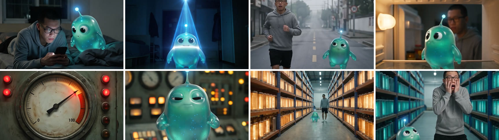

# AI 科普短剧 · AI Science Series

[中文](#中文) · [English](#english)



《睡觉真的比健身重要一万倍？》前 3 段，90 秒，即梦 Seedance 2.5 全能参考一段段生成（480p）。视频文件：[`assets/demo.mp4`](assets/demo.mp4)。这是第一版测试，外星人还是早期的果冻造型，例子里已经改成人形。

---

## 中文

**一个爱立 flag 的普通人 + 一个只信数据的外星人**：阿杰决定每天只睡 5 小时、省下的时间全拿去健身，外星人啵啵赌他 100 天后来求她。第 1 天、第 3 天、第 7 天……每讲一个知识点，镜头就钻进冰箱灯、杠铃孔、体重秤屏幕，进到身体里的「控制室」「电池仓库」「工地」，一句台词配一个画面。写实电影风，两人对话，4 分半。

这个仓库是做这种 **AI 科普短剧** 的完整流程，免费开源：说一个话题，就查证、写剧本、拆段、出全部提示词。

- **Claude Skill**：装进 [Claude Code](https://claude.com/claude-code) 后说「出一集：空腹喝咖啡到底伤不伤胃？」
- **先查证**：台词里每个数字都有一手出处（作者、期刊、多少人），查不到的不写
- **固定的剧情架构**：钩子 → 打赌 → 第 N 天时间线 → 钻进比喻场景 → 求饶、赌约兑现 → 揭晓代价 → 下期新赌约，伏笔前后呼应
- **提示词自动拼**：按时长拆成 30 秒一段；每段一张写实分镜（不带序号、每格标人数）+ 一份视频提示词（参考图编号、台词、画外音、转场、秒数自动对齐）
- **改一格、补几秒**：分镜某一格、视频某几个镜头不对，只重做那一点

### 做法

| | 是什么 | 在哪做 |
| --- | --- | --- |
| ① 设定图 | 两个角色（三视图 + 正脸特写 + 表情）+ 主角的房间（两个角度） | 即梦画布 · 图片生成 |
| ② 分镜图 | 每 30 秒一张写实八宫格 | 即梦画布 · 图片生成（框选设定图） |
| ③ 视频 | 设定图 + 分镜 + 按秒写的镜头、台词、音效，一次 30 秒 | 即梦画布 · Seedance 2.5 全能参考 |
| ④ 拼接 | 几段拼成一条，铺音乐、加字幕和「第 N 天」 | 脚本 + 剪映 |

### 时长

| 时长 | 段数 | 知识点 |
| --- | --- | --- |
| 1 分钟 | 2 | 1–2 |
| 3 分钟 | 6 | 4–5 |
| 5 分钟 | 10 | 7–8 |

### 例子

[`examples/sleep-vs-gym/`](examples/sleep-vs-gym/)：《睡觉真的比健身重要一万倍？》，9 段，[剧本](examples/sleep-vs-gym/ep01/剧本.md)（带 8 个研究的出处表）、[全部提示词](examples/sleep-vs-gym/ep01/提示词.md)、[设定图提示词](examples/sleep-vs-gym/设定图提示词.md)。

### 你需要

- 即梦会员（画布 + Seedance 2.5）；海外用 Dreamina，提示词通用
- 跑脚本：Python 3.9+、ffmpeg、`pip install pillow`

### 安装成 Claude Skill

把这个仓库的链接丢给 Claude Code，说「帮我装成 Skill」。或者：

```bash
git clone https://github.com/10291124jcjc-dotcom/ai-science-series.git ~/.claude/skills/ai-science-series
```

### 只用脚本

```bash
python scripts/setup_check.py my-series ep01                # 检查环境、建文件夹、复制模板
python scripts/make_prompts.py my-series sheets             # 角色、大本营的设定图提示词
python scripts/make_prompts.py my-series ep01 script        # 剧本（含出处表）
python scripts/make_prompts.py my-series ep01               # 全部分镜 + 视频提示词，一份文件
python scripts/make_prompts.py my-series ep01 panel 6 --seg 3   # 只重出第 3 段分镜的第 6 格
python scripts/make_prompts.py my-series ep01 patch 5-6 --seg 3 # 只补拍第 3 段的镜头 5–6
python scripts/review_clip.py my-series ep01                # 抽帧检查生成的视频
python scripts/compile.py concat 成片.mp4 第1段.mp4 第2段.mp4 ...
```

### 注意

- 只做原创角色：不用真人，不照搬别人账号的角色和台词，只学剧情架构
- 数字必须有出处；健康话题不给治疗建议
- 配乐用你自己有版权的；发布时标注 AI 生成

### 作者

硅基废话（X：[@DDJCXX](https://x.com/DDJCXX)）。做出来的视频欢迎 @ 我。

其他项目：[AI 动画单元剧](https://github.com/10291124jcjc-dotcom/ai-anime-series) · [古人说唱 Battle](https://github.com/10291124jcjc-dotcom/ancient-rap-battle) · [埃及艳后的现代日常](https://github.com/10291124jcjc-dotcom/cleopatra-modern-life)

---

## English

**A stubborn guy + an alien who only trusts data.** Each episode he takes on a challenge ("sleep 5 hours a day for 100 days and spend the rest at the gym"), she bets he'll come begging, and the story walks day by day. Every fact is a camera move *into* the body — through the fridge light into a hunger control room, through a barbell plate into a battery warehouse. Realistic, two-character dialogue, 2–5 minutes.

This repo is the full workflow: give a topic, get verified facts (every number traced to a primary study), a script in a fixed story structure, and all storyboard + video prompts for Jimeng / Dreamina Seedance 2.5 omni-reference, split into 30-second segments.

**Install**: give this repo's link to Claude Code and say "install it as a skill", or `git clone` it into `~/.claude/skills/ai-science-series`.

**Rules**: original characters only (learn the story structure, don't copy other creators' characters or lines); every number needs a primary source; no medical advice; label videos as AI-generated.

Code in `scripts/` is MIT; everything else is CC BY-NC 4.0. See [LICENSE](LICENSE).
